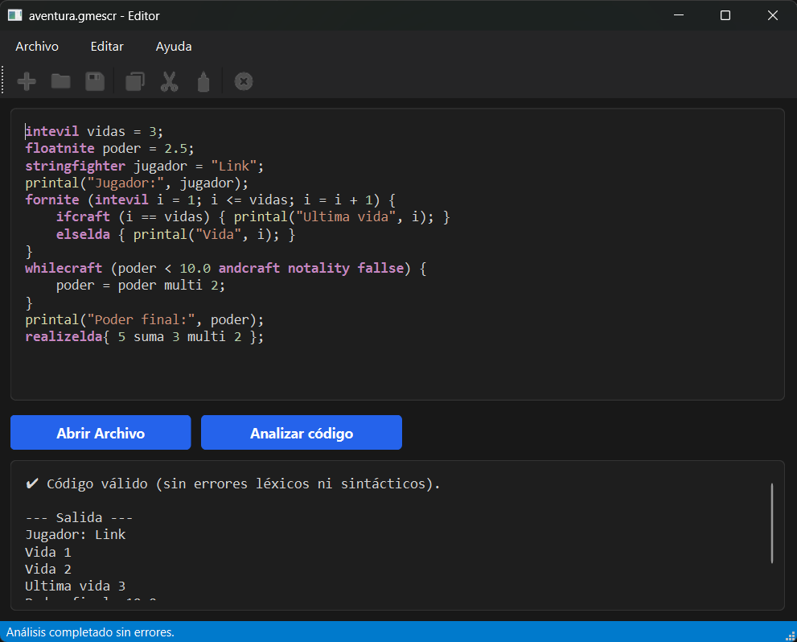
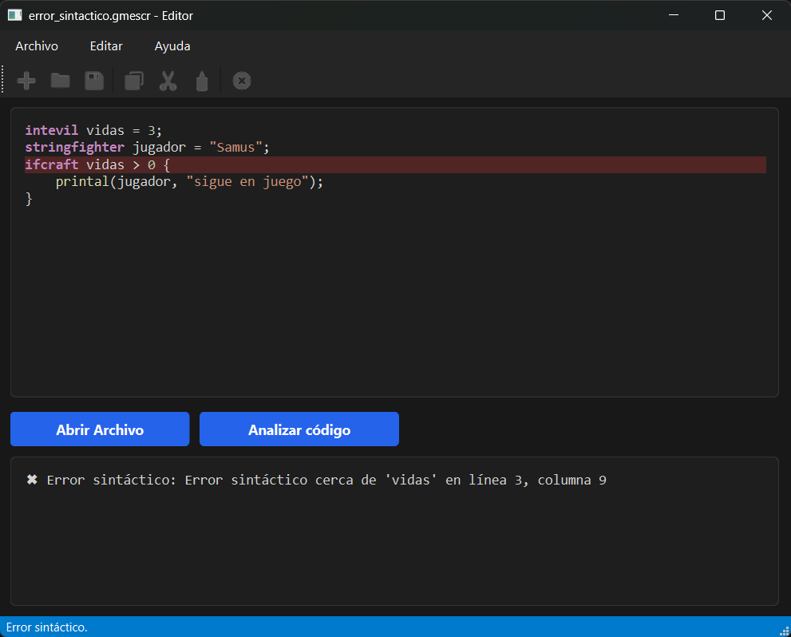

# GameScript

Lenguaje de programación con palabras reservadas inspiradas en videojuegos. Incluye un analizador léxico y sintáctico hecho con **PLY** (Python Lex-Yacc), un intérprete y un editor gráfico hecho con **PyQt6**.

Proyecto final del **Equipo YDL**:

- Leonardo Damian Hernandez Hernandez
- Yurem Jesus Aco Luna
- Diana Nicole Uribe Hernandez



## Contenido

- [¿Qué es GameScript?](#qué-es-gamescript)
- [Ejemplo rápido](#ejemplo-rápido)
- [Requisitos](#requisitos)
- [Instalación](#instalación)
- [Ejecución](#ejecución)
- [Uso del editor](#uso-del-editor)
- [El lenguaje](#el-lenguaje)
- [Cómo funciona](#cómo-funciona)
- [Estructura del proyecto](#estructura-del-proyecto)
- [Documentación](#documentación)

## ¿Qué es GameScript?

GameScript es un lenguaje imperativo, pequeño y con tipos declarados. Cada palabra reservada combina una palabra clave clásica con el nombre de un videojuego: `intevil` (int + Resident Evil), `ifcraft` (if + Minecraft), `printal` (print + Portal), `elselda` (else + Zelda), etc.

Sirve para escribir programas cortos con variables, operaciones aritméticas y lógicas, condiciones, ciclos y salida en pantalla. Su objetivo es didáctico: en un solo editor se ven las fases de un compilador (análisis léxico, análisis sintáctico y ejecución con comprobación de tipos) y la línea exacta donde hay un error.

Los programas se guardan con la extensión `.gmescr`.

## Ejemplo rápido

```text
intevil vidas = 3;
floatnite poder = 2.5;
stringfighter jugador = "Link";
printal("Jugador:", jugador);
fornite (intevil i = 1; i <= vidas; i = i + 1) {
    ifcraft (i == vidas) { printal("Ultima vida", i); }
    elselda { printal("Vida", i); }
}
whilecraft (poder < 10.0 andcraft notality fallse) {
    poder = poder multi 2;
}
printal("Poder final:", poder);
realizelda{ 5 suma 3 multi 2 };
```

Salida en la consola del editor:

```text
Jugador: Link
Vida 1
Vida 2
Ultima vida 3
Poder final: 10.0
Resultado 1: 11
```

## Requisitos

| Herramienta | Versión |
|---|---|
| Python | 3.10 o superior (probado con 3.13) |
| Git | Cualquier versión reciente |
| PyQt6 | 6.x (probado con 6.12.0) |
| PLY | 3.11 |

## Instalación

1. Clona el repositorio y entra a la carpeta:

   ```bash
   git clone https://github.com/LeoDamHdz2/ProyectoFinalCompiladorAhoraSi.git
   ```

   ```bash
   cd ProyectoFinalCompiladorAhoraSi
   ```

2. Crea y activa un entorno virtual (recomendado):

   ```bash
   python -m venv .venv
   ```

   | Terminal | Comando para activarlo |
   |---|---|
   | PowerShell | `.venv\Scripts\Activate.ps1` |
   | CMD | `.venv\Scripts\activate.bat` |
   | Linux / macOS | `source .venv/bin/activate` |

   Si PowerShell no permite activar el entorno, ejecuta una vez `Set-ExecutionPolicy -Scope CurrentUser RemoteSigned` o usa CMD.

3. Instala las dependencias:

   ```bash
   pip install PyQt6 ply
   ```

   Para usar exactamente las versiones con las que se probó: `pip install PyQt6==6.12.0 ply==3.11`.

## Ejecución

Desde la carpeta del proyecto, con el entorno virtual activado:

```bash
python app.py
```

Para correr las pruebas del analizador (deben terminar con `OK`):

```bash
python -m unittest test_gramatica -v
```

En Linux o macOS usa `python3` si `python` no está disponible.

## Uso del editor

1. Escribe un programa en el editor o usa **Abrir Archivo** para cargar un archivo `.gmescr` o `.txt`. La carpeta [`EJEMPLOS/`](EJEMPLOS) trae programas listos para probar.
2. Presiona **Analizar código**.
3. La consola muestra «Código válido» y la salida del programa, o el tipo de error con su línea y columna. La línea con el error se resalta en rojo.



| Acción | Menú | Atajo |
|---|---|---|
| Nuevo archivo | Archivo › New | `Ctrl+N` |
| Abrir archivo | Archivo › Abrir… | `Ctrl+O` |
| Abrir un archivo reciente | Archivo › Abrir Reciente… | — |
| Guardar (`.gmescr` por defecto) | Archivo › Save | `Ctrl+S` |
| Copiar / Cortar / Pegar | Editar › Copy / Cortar / Paste | `Ctrl+C` / `Ctrl+X` / `Ctrl+V` |
| Buscar y reemplazar | Editar › Encontrar y Remplazar… | `Ctrl+F` |

El editor avisa si intentas cerrar o abrir otro archivo con cambios sin guardar.

## El lenguaje

### Palabras reservadas

| GameScript | Equivale a | Inspiración |
|---|---|---|
| `intevil` | `int` | Resident Evil |
| `floatnite` | `float` | Fortnite |
| `stringfighter` | `string` | Street Fighter |
| `printal` | `print` | Portal |
| `ifcraft` | `if` | Minecraft |
| `elselda` | `else` | The Legend of Zelda |
| `whilecraft` | `while` | Warcraft |
| `fornite` | `for` | Fortnite |
| `truetroid` | `true` | Metroid |
| `fallse` | `false` | Fall Guys |
| `andcraft` | `and` (`&&`) | Minecraft |
| `orizon` | `or` (`\|\|`) | Horizon |
| `notality` | `not` (`!`) | Mortal Kombat (Fatality) |
| `realizelda` | evaluar y numerar un resultado | The Legend of Zelda |

Los operadores aritméticos también se pueden escribir con palabras: `suma` (+), `resta` (-), `multi` (*) y `divi` (/). Pueden ir pegados a los números, por ejemplo `realizelda{1suma1};`.

### Reglas principales

- **Instrucciones:** las declaraciones, asignaciones, `printal` y `realizelda` terminan en `;`. Los bloques y las estructuras de control no.
- **Tipos:** `intevil` (enteros), `floatnite` (decimales) y `stringfighter` (texto). No hay tipo booleano; `truetroid` y `fallse` se usan en condiciones.
- **Declaración:** `tipo nombre;` o `tipo nombre = expresión;`. Sin valor inicial, la variable vale `0`, `0.0` o `""`.
- **Tipos estrictos:** `intevil` solo acepta enteros, `floatnite` acepta enteros o decimales y `stringfighter` solo acepta texto. Las variables se declaran antes de usarse y no se pueden declarar dos veces en el mismo ámbito.
- **Bloques:** `{ }` agrupa instrucciones y crea un ámbito nuevo.
- **Control de flujo:** `ifcraft (cond) { } elselda { }`, `whilecraft (cond) { }` y `fornite (inicio; cond; actualización) { }`. La condición va entre paréntesis y el cuerpo siempre lleva llaves.
- **Salida:** `printal(a, b, ...);` muestra los valores separados por espacios. `realizelda{ expresión };` muestra `Resultado N: valor`.
- **Operadores:** `+ - * /`, `== != < <= > >=`, `&& || !` y menos unario. Los paréntesis cambian la precedencia.
- **Identificadores:** empiezan con letra o `_` y siguen con letras, dígitos o `_`. Solo caracteres ASCII: la `ñ` y los acentos no se permiten.

### Precedencia (de mayor a menor)

1. `notality` / `!` y menos unario
2. `multi` / `*` y `divi` / `/`
3. `suma` / `+` y `resta` / `-`
4. `<  <=  >  >=`
5. `==  !=`
6. `andcraft` / `&&`
7. `orizon` / `||`

### Lo que no incluye

Comentarios, funciones de usuario, arreglos, `++` / `--`, asignación compuesta, operador ternario, `else if`, `break`, `continue` y lectura de datos. Los ciclos tienen un límite total de 100 000 iteraciones para evitar bucles infinitos.

## Cómo funciona

```text
Código fuente (.gmescr)
  → Análisis léxico     (ply.lex: tokens y expresiones regulares)
  → Análisis sintáctico (ply.yacc: parser LALR, 60 producciones)
  → Árbol sintáctico    (clases dataclass)
  → Intérprete          (ámbitos y comprobación de tipos)
  → Consola del editor  (salida o mensaje de error)
```

El editor distingue tres tipos de error:

| Tipo | Ejemplo de mensaje |
|---|---|
| Léxico | `Carácter no válido 'ñ' en línea 2, columna 11` |
| Sintáctico | `Error sintáctico cerca de 'vidas' en línea 3, columna 9` |
| Ejecución / tipos | `La variable 'vidas' requiere un valor de tipo int.` |

## Estructura del proyecto

```text
├── app.py                  Ventana principal: menús, archivos, búsqueda y análisis
├── gramatica.py            Tokens, expresiones regulares, producciones PLY e intérprete
├── principal.py            Interfaz generada con pyuic6 a partir de interfazArchivo.ui
├── interfazArchivo.ui      Diseño de la ventana (Qt Designer)
├── colores.py              Resaltado de sintaxis del editor
├── test_gramatica.py       Pruebas unitarias del analizador y del intérprete
├── GRAMATICA.txt           Descripción completa de la gramática
├── EJEMPLOS/               Programas de ejemplo en GameScript
├── Images/                 Íconos de menús y barra de herramientas
├── docs/                   Capturas usadas en este README
├── parsetab.py             Tabla generada por PLY en una versión anterior
└── Reporte_EquipoYDL.pdf   Reporte del proyecto
```

## Documentación

- [`GRAMATICA.txt`](GRAMATICA.txt): todas las reglas del lenguaje.
- [`Reporte_EquipoYDL.pdf`](Reporte_EquipoYDL.pdf): descripción del lenguaje, explicación de la gramática en PLY, capturas de la interfaz y manual de configuración.
